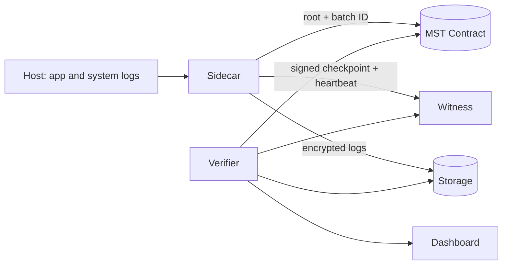

# TraceLedger — Product Requirements Document (PRD)

**Version:** 0.1 (MVP / Hackathon)
**Event:** MST Blockchain BUILDATHON #2
**Build window:** 5 days, 2–4 developers
**Audience:** Developers and AI coding agents (Antigravity). Read this fully before writing code.

---

## 0. Instructions for the coding agent

1. Read this PRD and `docs/ARCHITECTURE.md` (if present) before any change.
2. Build **one milestone at a time** (Section 12). Do not start the next milestone until the current one's acceptance tests pass.
3. Do not touch folders outside the current milestone's scope.
4. Never include real private keys, seed phrases or secrets. Use `.env` and a testnet-only wallet. Add `.env` to `.gitignore`.
5. Do not invent MST RPC URLs, chain IDs, fees, finality times or TPS numbers. Use placeholders `MST_RPC_URL`, `MST_CHAIN_ID` and mark them "verify in MST docs".
6. Prefer simple, well-known libraries. No zero-knowledge proofs in the MVP.
7. Write tests for every module. Explain each change briefly.
8. Claim only tamper **detection**. Never claim the system prevents attacks, identifies attackers, or proves every event was captured.
9. Ask before running destructive terminal commands (`rm`, `sudo`, piping `curl` into a shell).

---

## 1. Overview

**TraceLedger** is a tamper-evident security-log integrity system built on **MST Blockchain**. A lightweight sidecar hashes security events into signed Merkle batches and anchors each batch's root on MST. A remote witness and an independent verifier detect altered, missing, reordered or delayed records, even if an attacker has root access to the host.

**Tagline:** Trust the evidence, not just the server.

## 2. Problem statement

When a server is compromised, attackers with root access can alter or delete local logs, erasing the evidence of what they did. Most logging systems share a trust boundary with the systems they monitor, so the attacker who breaches the host can also rewrite the record of the breach. Enterprise WORM storage is costly and complex, and central log servers are a single point of trust. Small teams have no affordable way to prove their logs are intact.

**Pain points**
1. Logs sit inside the attacker's reach.
2. Tampering goes unnoticed or is found late.
3. Trustworthy log storage is costly or centralized.

## 3. Goals and non-goals

### Goals (MVP)
- G1: Collect security events from at least 3 sources on demo hosts.
- G2: Seal events into signed, chained Merkle batches.
- G3: Anchor each batch root on MST testnet via a Solidity contract.
- G4: Detect tampered, missing, reordered, delayed and unanchored records.
- G5: Detect a silent or disabled sidecar via witness heartbeats.
- G6: Show results in a dashboard with an exact failure location.
- G7: Provide a repeatable attack-simulation demo.

### Non-goals (MVP)
- Preventing attacks or blocking attackers.
- Identifying attacker identity.
- Proving every event was captured (host compromised before install).
- Windows or cloud log collection, multi-chain anchoring, zero-knowledge proofs, hardware key custody, AI features.
- Production-grade key management.

## 4. Target users and personas

| Persona | Need | Pain |
|---|---|---|
| Small-team DevOps / sysadmin (startup, college, NGO) | Prove logs are untouched after an incident | No budget for WORM or enterprise SIEM |
| Security analyst / incident responder | Reliable timeline of what happened | Cannot trust logs from a rooted host |
| Auditor / compliance officer | Independently verify log integrity | Must take the operator's word |
| Falsely blamed admin | Show history was not altered | No neutral proof |

## 5. User stories

- US1: As an admin, I install the sidecar on a host so its security events are sealed automatically.
- US2: As an analyst, I run verification and see which batch and record were altered.
- US3: As an auditor, I verify a log batch against the chain without trusting the operator.
- US4: As an admin, I get an alert when a sidecar stops sending heartbeats.
- US5: As a judge, I watch a log line get edited and see the dashboard turn red.

## 6. Scope and system components

1. **Sidecar agent** (Python)
2. **Smart contract** (Solidity, Hardhat) on MST
3. **Witness service** (FastAPI)
4. **Verifier service** (FastAPI / Python library)
5. **Dashboard** (React + Tailwind)
6. **Storage** (SQLite + encrypted files)
7. **Attack simulation script**



## 7. Functional requirements

### 7.1 Sidecar
| ID | Requirement | Priority |
|---|---|---|
| FR-S1 | Tail Linux `auth.log` (or journald), one Docker container log, and one app log file | Must |
| FR-S2 | Normalize events into the event schema (Section 9) | Must |
| FR-S3 | Redact sensitive fields and add a per-record random salt before hashing | Must |
| FR-S4 | Assign a monotonic sequence number per host | Must |
| FR-S5 | Hash each event with SHA-256 | Must |
| FR-S6 | Group events into batches (every N events or T seconds, configurable) | Must |
| FR-S7 | Build a Merkle tree per batch; chain each batch to the previous batch hash | Must |
| FR-S8 | Sign each batch with the host's Ed25519 key | Must |
| FR-S9 | Submit the batch root on-chain; record the transaction hash | Must |
| FR-S10 | Send signed checkpoint to the witness; send heartbeat every X seconds | Must |
| FR-S11 | Store batch data locally and encrypt raw logs at rest | Must |
| FR-S12 | Run as a low-privilege user with read-only log access | Should |
| FR-S13 | Retry anchoring and witness submission with backoff; queue when offline | Should |

### 7.2 Smart contract
| ID | Requirement | Priority |
|---|---|---|
| FR-C1 | `registerAgent(agentId, publicKeyHash)` restricted to the owner | Must |
| FR-C2 | `anchorRoot(agentId, batchId, merkleRoot, previousRoot)` callable by the registered agent | Must |
| FR-C3 | Enforce monotonic `batchId` per agent; reject duplicates and gaps | Must |
| FR-C4 | Store root, previous root and `block.timestamp` | Must |
| FR-C5 | `getBatch(agentId, batchId)` view function | Must |
| FR-C6 | Emit `AgentRegistered` and `RootAnchored` events | Must |
| FR-C7 | Aggregator support (root of roots) | Future |

### 7.3 Witness
| ID | Requirement | Priority |
|---|---|---|
| FR-W1 | Accept and verify signed checkpoints and heartbeats | Must |
| FR-W2 | Store checkpoints independently of the host | Must |
| FR-W3 | Flag missing heartbeats beyond a timeout | Must |
| FR-W4 | Flag sequence gaps and out-of-order batches | Must |
| FR-W5 | Expose read APIs for the verifier and dashboard | Must |
| FR-W6 | Multiple witnesses with quorum co-signing | Future |

### 7.4 Verifier
| ID | Requirement | Priority |
|---|---|---|
| FR-V1 | Recompute event hashes and Merkle roots from stored logs | Must |
| FR-V2 | Compare roots with on-chain data and witness checkpoints | Must |
| FR-V3 | Detect and classify: **tampered**, **missing**, **reordered**, **delayed**, **unanchored** | Must |
| FR-V4 | Report the exact batch ID and record index of each failure | Must |
| FR-V5 | Verify the previous-root chain between batches | Must |
| FR-V6 | Verify batch signatures against the registered public key | Must |
| FR-V7 | Produce a machine-readable verification report (JSON) | Must |

### 7.5 Dashboard
| ID | Requirement | Priority |
|---|---|---|
| FR-D1 | Host list with status (healthy, tampered, silent) | Must |
| FR-D2 | Batch timeline with green/red verification status | Must |
| FR-D3 | Failure detail: batch, record, type, expected vs actual hash | Must |
| FR-D4 | Link each batch to its MST transaction hash | Must |
| FR-D5 | "Run verification" button | Must |
| FR-D6 | Alert banner for silent sidecars | Should |
| FR-D7 | Time-travel replay of the verified event timeline | Future |
| FR-D8 | One-click incident report PDF with QR proof | Future |

### 7.6 Attack simulation
| ID | Requirement | Priority |
|---|---|---|
| FR-A1 | Script generates sample events and triggers anchoring | Must |
| FR-A2 | Script edits one stored log line (labelled as simulation) | Must |
| FR-A3 | Script deletes a line and, separately, a whole batch | Must |
| FR-A4 | Script stops the sidecar to trigger the witness alert | Should |

## 8. Non-functional requirements

- **Integrity:** Any change to committed data must change the verification result.
- **Privacy:** No raw logs or personal data on-chain. Minimize PII; hash salted values only.
- **Performance:** Sidecar CPU overhead should stay low on a demo VM. Measure and report; do not invent numbers.
- **Reliability:** Sidecar survives temporary chain or witness outages by queueing.
- **Security:** Secrets in environment variables only; private keys never committed or logged.
- **Usability:** Setup in under 15 minutes from a clean clone, documented in the README.
- **Observability:** Structured logging for every service.

## 9. Data models (JSON)

**Event**
```json
{
  "hostId": "host-a",
  "seq": 101,
  "timestamp": "ISO-8601",
  "source": "auth.log | docker | app",
  "eventType": "login_failed",
  "payload": { "...redacted fields..." },
  "salt": "base64",
  "eventHash": "hex SHA-256"
}
```

**Batch**
```json
{
  "hostId": "host-a",
  "batchId": 12,
  "firstSeq": 101,
  "lastSeq": 150,
  "merkleRoot": "hex",
  "previousRoot": "hex",
  "createdAt": "ISO-8601",
  "signature": "base64 Ed25519",
  "txHash": "0x..."
}
```

**Checkpoint / heartbeat**
```json
{
  "hostId": "host-a",
  "batchId": 12,
  "merkleRoot": "hex",
  "lastSeq": 150,
  "sentAt": "ISO-8601",
  "signature": "base64"
}
```

**Verification report**
```json
{
  "hostId": "host-a",
  "status": "tampered",
  "findings": [
    { "batchId": 7, "recordIndex": 3, "type": "tampered",
      "expectedHash": "hex", "actualHash": "hex" }
  ],
  "verifiedAt": "ISO-8601"
}
```

## 10. API surface (draft)

**Witness**
- `POST /checkpoints`
- `POST /heartbeats`
- `GET /hosts/{hostId}/checkpoints`
- `GET /hosts/{hostId}/status`

**Verifier**
- `POST /verify/{hostId}`
- `GET /reports/{hostId}/latest`

**Dashboard** consumes the Witness and Verifier APIs.

## 11. Cryptography and verification design

- **Hash:** SHA-256 with a per-record random salt kept off-chain.
- **Merkle tree:** Binary tree over ordered event hashes; define a rule for odd leaf counts and document it.
- **Chaining:** Each batch includes the previous batch's root, so removing or reordering batches breaks the chain.
- **Signature:** Ed25519 per host; public key hash registered on-chain.
- **Verification algorithm (summary):**
  1. Load the stored events for the host in sequence order.
  2. Check sequence continuity; flag gaps as **missing**.
  3. Recompute event hashes; mismatches are **tampered**.
  4. Rebuild each batch's Merkle root; compare with the on-chain root and witness checkpoint.
  5. Verify the previous-root chain and batch signatures.
  6. Compare timestamps; flag batches anchored or checkpointed beyond the allowed delay as **delayed**.
  7. Flag batches present locally but not on-chain as **unanchored**.

## 12. Milestones and acceptance criteria

| Day | Milestone | Acceptance tests |
|---|---|---|
| 1 | Sidecar core: ingest, normalize, seq, hash, Merkle, sign, local storage | Unit tests pass; same input gives same root; changing one event changes the root |
| 2 | Verifier: recompute and detect tampered, missing, reordered | Tests for each tamper type; report names the exact batch and record |
| 3 | Smart contract and deployment | Hardhat tests pass; duplicate or gapped batch IDs rejected; contract deployed to MST testnet; sidecar anchors a root |
| 4 | Witness service and dashboard | Heartbeat timeout flags a silent host; dashboard shows green/red status and tx links |
| 5 | Attack simulation, measurements, polish | Demo runs end to end from a clean start; measured cost and latency recorded |

## 13. Demo script (5 minutes)

1. Show hosts A and B healthy (green).
2. Generate events; show batches anchored with MST tx links.
3. Run the simulation: edit one log line on host A (labelled simulation).
4. Click "Run verification": host A turns red and shows the exact batch and record; host B stays green.
5. Stop the sidecar on host A; the witness flags a silent host.
6. Explain limits honestly: host compromised before install, key theft.

## 14. Success metrics

- 100% of simulated tamper cases (edit, delete, reorder, drop batch) detected in the demo.
- Time from tampering to detection (measured).
- Cost per batch and confirmation latency on MST (measured, not assumed).
- Setup time from a clean clone.

## 15. Risks and mitigations

| Risk | Mitigation |
|---|---|
| Host rooted before the sidecar starts | State as a limitation; use witness and heartbeats |
| Stolen signing key | Per-host keys; document as a limitation; key rotation noted as future work |
| Witness compromise | Public anchor plus future quorum witnesses |
| MST testnet unavailable or details unclear | Develop against a local Hardhat node first; keep chain config in env vars |
| Clock drift | NTP on hosts; use chain timestamps as the reference |
| Judges see it as "just hashing" | Demo with live tampering; explain why a neutral anchor beats a witness alone |
| Scope creep | Hold "Future" items until all "Must" items pass |

## 16. Dependencies and assumptions

- MST testnet RPC, chain ID and faucet are available *(verify in MST docs)*.
- Solidity contracts deploy to MST with standard EVM tooling *(verify)*.
- Demo hosts: one Linux VM, one Docker container, one sample app.
- Monitoring is limited to systems the team owns or has permission to monitor.

## 17. Open questions

1. Exact MST testnet RPC URL, chain ID, fees and finality.
2. Key custody approach for the demo.
3. Batch size and time thresholds.
4. Whether to include the aggregator (root of roots) in the MVP.
5. Legal wording for any "evidence" or "compliance" claims.

## 18. Future work

Time-travel replay, one-click incident report with QR proof, honeypot capture, multi-witness quorum, Windows and cloud collectors, aggregator for multi-host anchoring.
