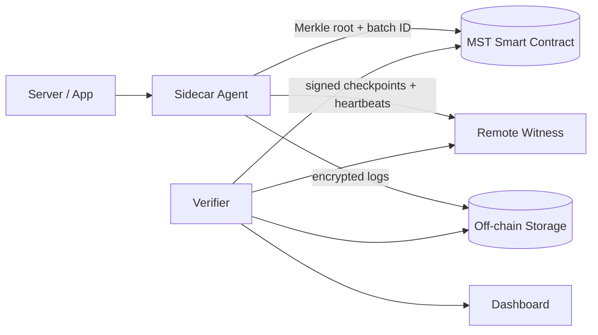

# TraceLedger

**Trust the evidence, not just the server.**

TraceLedger is a tamper-evident security-log system built on **MST Blockchain**. It seals the history of security events so that any later edit, deletion, reordering or gap in the logs can be detected, even if an attacker gains root access to the host.

> Built for **MST Blockchain BUILDATHON #2**.

---

## The problem

When a server is compromised, attackers with root access can edit or delete local logs to hide what they did. Most logging systems share a trust boundary with the systems they monitor, so the same attacker who breaches the host can also rewrite the record of the breach.

Common fixes are costly or still rely on trusting one party: enterprise WORM storage is expensive and complex, and a central log server is a single point of trust and failure. Small teams running Linux servers and microservices have no affordable way to prove their logs are intact.

**Pain points**

1. Logs sit inside the attacker's reach, so evidence can be erased with root access.
2. Tampering is often detected late or never.
3. Trustworthy log storage is costly or relies on one central party.

## The solution

A lightweight sidecar seals each batch of security events by anchoring a compact cryptographic commitment (a Merkle root) on MST Blockchain. An independent verifier later checks stored logs against those commitments. Raw logs never go on-chain.

### How it works

1. **Collect:** the sidecar captures security events (logins, permission changes, config changes, errors).
2. **Sanitize:** sensitive fields are redacted or salted; each event gets a monotonic sequence number.
3. **Hash:** each event is hashed with SHA-256.
4. **Batch:** hashes are grouped into a Merkle tree, producing one root per batch, chained to the previous batch.
5. **Sign:** each batch is signed with an Ed25519 key.
6. **Anchor:** the Merkle root, batch ID and timestamp are written to a Solidity smart contract on MST.
7. **Witness:** signed checkpoints and heartbeats go to a remote witness that watches for missing batches or a dead sidecar.
8. **Verify:** an independent verifier recomputes hashes and roots and compares them with the chain and the witness. Any mismatch raises an alert pointing to the exact batch and record.

### Architecture overview



## What goes on-chain vs off-chain

| On-chain (MST) | Off-chain |
|---|---|
| Merkle root per batch | Raw log events |
| Batch ID and previous root | Salts and sensitive fields |
| Timestamp | Encrypted log files |
| Registered agent ID | Witness checkpoints and heartbeats |

## Why MST Blockchain

- **EVM-compatible**, so Solidity contracts and standard tooling (Hardhat, MetaMask, Remix) work with minimal changes. *(Verify against current MST docs.)*
- **Suited to frequent anchoring** of small commitments. *(We will measure and publish our own cost and latency numbers.)*
- **India-built**, a good fit for Indian startups and SMEs wanting locally rooted evidence infrastructure.
- **Developer onboarding tools** such as the SARAL Protocol SDK. *(Used only if integrated in the MVP.)*

## What TraceLedger does and does not do

**Does**

- Detects altered, deleted, reordered, delayed or unanchored records in committed history.
- Detects a disabled sidecar through witness heartbeats and sequence gaps.
- Keeps raw logs private while still proving integrity.

**Does not**

- Prevent attacks.
- Identify attackers, who can hide behind VPNs, Tor or spoofed IPs.
- Prove that every event was captured. If a host was compromised before the sidecar started, events may be missing.
- Protect against a stolen signing key. Key management is a stated limitation.

## Demo scenario

1. Generate a few test events on a sample server.
2. Anchor their Merkle root on MST testnet.
3. Simulate an admin editing one log line (clearly labelled as a simulation).
4. Run the verifier. The dashboard turns red and shows the exact batch and record that no longer matches.

## Tech stack

| Layer | Technology |
|---|---|
| Sidecar | Python |
| Cryptography | SHA-256, Merkle trees, Ed25519 |
| Smart contract | Solidity, Hardhat |
| Chain | MST Blockchain (testnet) |
| Backend / witness / verifier | FastAPI |
| Dashboard | React, Tailwind CSS |
| Storage | SQLite and encrypted files |

## Repository structure

```
traceledger/
├── sidecar/        # event collection, hashing, Merkle, signing
├── contracts/      # Solidity contract and Hardhat tests
├── backend/        # witness and verifier services (FastAPI)
├── dashboard/      # React + Tailwind UI
├── scripts/        # attack simulation and demo helpers
├── docs/           # architecture and threat model
└── README.md
```

## Getting started

> Commands below are a template. Adjust to the final project layout.

```bash
# 1. Clone
git clone <repo-url> traceledger && cd traceledger

# 2. Configure environment (never commit real keys)
cp .env.example .env
# Set: MST_RPC_URL, MST_CHAIN_ID, TESTNET_PRIVATE_KEY, WITNESS_URL
# Get RPC URL, chain ID and faucet details from the official MST docs.

# 3. Sidecar and backend
pip install -r requirements.txt

# 4. Contracts
cd contracts && npm install && npx hardhat test

# 5. Dashboard
cd ../dashboard && npm install && npm run dev
```

**Security notes:** use a fresh testnet-only wallet, keep secrets in `.env`, and never commit private keys or seed phrases.

## 5-day roadmap

| Day | Focus |
|---|---|
| 1 | Sidecar: event ingestion, sequence numbers, hashing, Merkle batches, signing |
| 2 | Verifier: recompute roots, detect tampered, missing and reordered records |
| 3 | Smart contract: anchor roots, tests, deploy to MST testnet |
| 4 | Witness service and dashboard |
| 5 | Attack simulation, measurements, demo and pitch polish |

## Planned extensions

- Time-travel replay of the verified attack timeline
- One-click incident report with a QR proof
- Honeypot capture of attacker activity
- Quorum of independent witnesses that co-sign each batch

## Metrics we will measure

- Cost per batch on MST
- Confirmation latency
- Records per transaction
- Time from tampering to detection

## Team

- Team name: _TBD_
- Members: _TBD_

## License

_TBD_